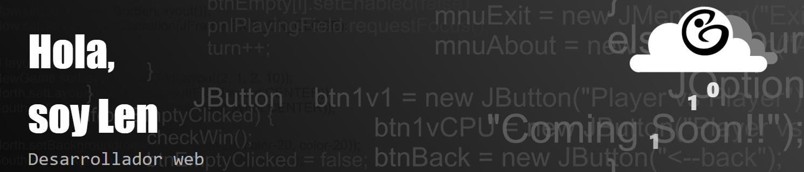

<h3 align="center">Desarrollador Backend / Full Stack · .NET · AWS · React</h3>

  
  
  

---

### 👋 Sobre mí

- 💻 Desarrollador **Backend / Full Stack** con más de 4 años de experiencia: APIs REST, microservicios y servicios **serverless** con **C# / .NET**, **Python** y **Node.js** sobre **AWS**, y frontends en **React + TypeScript**.
- 🏢 Hoy trabajo en **AmCham Argentina**: backend serverless en AWS, integración con el CRM **Dynamics 365** y notificaciones por **WhatsApp (Twilio)** y **email (SendGrid)**.
- 🤖 Uso la IA en el desarrollo todos los días: armé agentes de revisión de código para **Claude Code** que el equipo corre en cada cambio.
- 🎓 Licenciado en Gestión de la Tecnología y Técnico en Desarrollo Web (UNLaM).
- 🌎 Español nativo · Inglés intermedio (B1)

### 🚀 Lo que estuve haciendo

| | |
|---|---|
| 🔐 **Login unificado** | Backend serverless en Python (~22 Lambdas, API Gateway, DynamoDB, Cognito) y front en React. Reemplazó un sistema legacy sin desloguear a nadie y hoy da la sesión a 5 aplicaciones. |
| ⚙️ **Migración de runtimes** | 40 Lambdas pasadas a Node 24 y Python 3.14, sin runtimes vencidos en producción. |
| 📈 **Monitoreo** | Chequeo sintético cada 15 minutos y alarmas en CloudWatch con aviso por mail y Teams. |
| 🤖 **Agentes de IA** | 12 agentes para Claude Code (seguridad, calidad, rendimiento, costos, UX) empaquetados en plugins para el equipo. |

### 🛠️ Tecnologías

**Backend**

  

**Cloud (AWS)**

  
   
  
  
  
  
  
  

**Frontend**

  

**Bases de datos**

  
  
  

**Integraciones e IA**

  
  
  
  
  

**Herramientas**

  

### 📂 Algunos proyectos

| Proyecto | Qué es |
|---|---|
| <a href="https://www.amcham.com.ar/" target="_blank">AmCham Connect</a> | Frontend hecho desde cero en React + TypeScript |
| <a href="https://www.pce.amcham.com.ar/" target="_blank">Premio Ciudadanía Empresaria</a> | Sitio del premio de AmCham Argentina, en React + TypeScript |
| <a href="https://lenh22.github.io/TPGrupalVisualizacioneInterfaces/" target="_blank">CovPlus</a> | Trabajo práctico de Visualización e Interfaces (UNLaM) |
| <a href="https://tp-taller-2-libros.vercel.app/" target="_blank">Librería "El Romano"</a> | Tienda de libros de práctica, para Taller 2 (UNLaM) |
